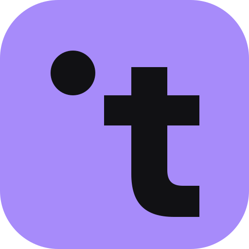
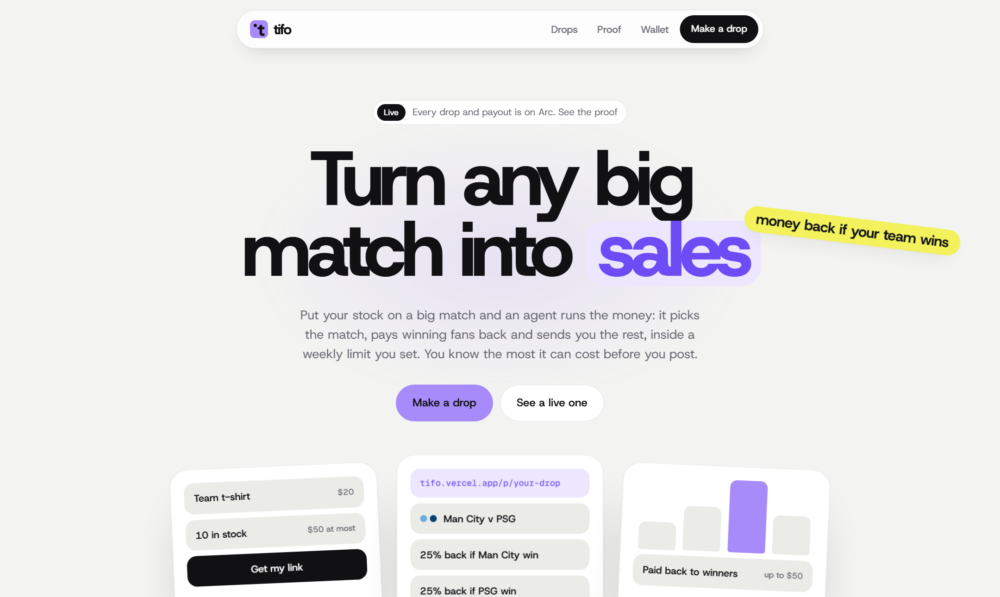
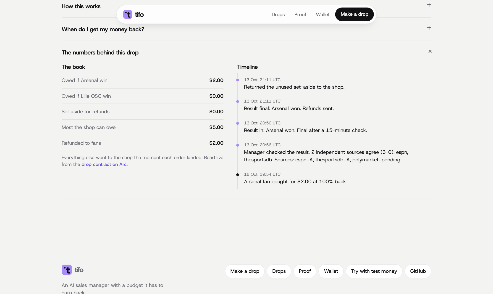
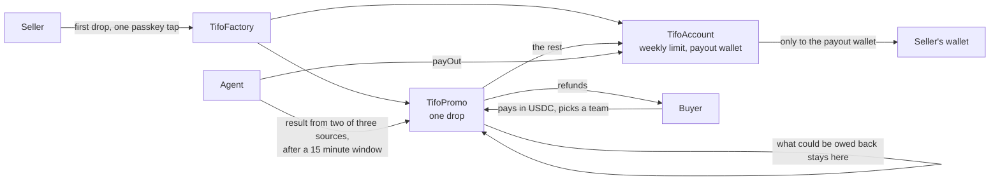

<p align="center">
  
</p>

<h1 align="center">Tifo</h1>

<p align="center">
  <b>Your matchday sales, run by an agent.</b><br>
  Put your stock on a big match. Buyers get money back if their team wins, and an agent runs the money inside a weekly limit you set.
</p>

<p align="center">
  <a href="https://tifo.vercel.app"></a>
  <a href="https://youtu.be/KK74r_sll74"></a>
  <a href="https://explorer.arc.io/address/0x7E9A6e16015dae854cB8D0370411552AD5f05c34"></a>
  <a href="https://github.com/jenzylove/tifo/actions/workflows/test.yml"></a>
  <a href="https://tameion.thecanteenapp.com"></a>
  <a href="LICENSE"></a>
</p>

<p align="center">
  
</p>

Small businesses don't have a product problem. They have a sales problem.

When sales are slow, the one tool a small seller has is a discount, and a flat discount gives money away on every order, including the ones that would have happened anyway. On match day it is sharper still: every customer they want is watching the game, not their shop. Fans respond to "money back if your team wins", but a small shop cannot run that safely. It cannot see what it would cost, buyers have no reason to trust a stranger to pay them back, and settling it means checking scores and sending refunds by hand.

Tifo turns the match into the promotion and hands the money to an agent. The seller sees the most a drop can cost before posting, a contract on Arc holds every refund until full time, and the agent runs everything from the first sale to the last payout.

<p align="center">
  
  <br><sub>Tuesday 13 October on Arc mainnet. Arsenal beat Lille: the agent checked the result, waited out the correction window and paid the buyer back, with nobody clicking anything.</sub>
</p>

## Start here

| | |
|---|---|
| Live site | https://tifo.vercel.app |
| Demo video, 2 minutes | https://youtu.be/KK74r_sll74 |
| Every decision the agent made, read from the chain | https://tifo.vercel.app/agent |
| The agent's record and every order | https://tifo.vercel.app/proof |
| First payout on mainnet | [`0xf0a800df…e0d8b1`](https://explorer.arc.io/tx/0xf0a800df76bb0d45f03ef5f81c5f30faff67f07e45712dfa20b3d7339ce0d8b1) |
| Try it with free test money | https://tifo-test.vercel.app |
| Contracts on Arc mainnet | [`TifoFactory 0x7E9A6e16…f05c34`](https://explorer.arc.io/address/0x7E9A6e16015dae854cB8D0370411552AD5f05c34) |
| What works, with transactions | [docs/BUILD_LOG.md](docs/BUILD_LOG.md) |
| Plan and acceptance tests | [docs/PRD.md](docs/PRD.md) |

## For judges: the rubric, mapped to the code

| Rubric | What to look at | Where it is |
|---|---|---|
| **Agentic sophistication** | The agent plans each drop with Claude (match, share back, balancing, buyers needed, referrals) and explains why. It runs every two minutes on its own: it rebalances offers as sales come in, reads results from ESPN, TheSportsDB and Polymarket and acts only when two agree, pays winners, returns the rest and sends sellers their money. Inside the weekly limit a seller sets on chain it opens the next drop by itself; above it the contract refuses, so it can only ask. It writes a daily briefing for each seller and answers questions in chat. | [`web/lib/dropPlan.ts`](web/lib/dropPlan.ts), [`web/lib/agent.ts`](web/lib/agent.ts), [`web/lib/results.ts`](web/lib/results.ts), [`web/lib/brief.ts`](web/lib/brief.ts), [`.github/workflows/tick.yml`](.github/workflows/tick.yml), [`contracts/src/TifoAccount.sol`](contracts/src/TifoAccount.sol) |
| **Proof the agent did it** | Every decision is written into the drop's contract with its reason, and the [agent log](https://tifo.vercel.app/agent) lists them all, newest first, each linked to Arc. Nobody can edit them. | `note()` and `getJournal()` in [`TifoPromo.sol`](contracts/src/TifoPromo.sol), [`web/lib/agentLog.ts`](web/lib/agentLog.ts) |
| **Traction** | Real shops and buyers on Arc mainnet with real USDC. Every number on [/proof](https://tifo.vercel.app/proof) and [/agent](https://tifo.vercel.app/agent) is read from the chain; our own test drops are listed separately and left out of every count. | [`web/app/proof/page.tsx`](web/app/proof/page.tsx), `isCheckDrop` in [`web/lib/promos.ts`](web/lib/promos.ts) |
| **Circle tools** | Two ways in, both Circle: Google sign-in on user-controlled wallets and passkeys on Modular Wallets, with Gas Station paying passkey wallets' gas. Card and bank top-ups through Onramp, USDC from other chains through Bridge Kit. | See [Circle and Arc](#circle-and-arc) |
| **Innovation** | Match-day cashback a small shop can run safely: the most it can cost is fixed on chain before posting, refunds are held in the drop until full time, and results settle with no one clicking. Referrals make an order free, paid for by the extra sales. Shipped orders are held until the buyer confirms. | [`TifoPromo.sol`](contracts/src/TifoPromo.sol), [`TifoReferral.t.sol`](contracts/test/TifoReferral.t.sol) |

---

## How it works

- **One link.** A seller adds a product, a price and how many they have (or starts from an Instagram post: a screenshot, the caption or the link). The agent plans the whole drop and says why: the match, how much back (any share from 10% to 100%), whether it balances the offer, whether the offer waits for a few buyers, and whether to turn on referrals. The seller posts it or changes what they like. One confirmation opens the drop and the seller's account on Arc, with a weekly limit and a payout wallet.
- **Buying.** Buyers open the link, pick a team and pay the normal price in USDC with a wallet made in seconds: continue with Google, or use a passkey. No seed phrase, no gas. Each sale locks only what could be owed back inside the drop and sends the rest on to the seller.
- **The cost is known up front.** The most a drop can cost is stock × price × share, shown before posting. Fans split between two teams and only one side wins, so a 25% back offer usually costs about what a 10% off sale does.
- **Full time.** The agent checks ESPN, TheSportsDB and Polymarket, proposes the result once two agree, waits a 15 minute correction window, then pays every winner and returns what is left. On a draw every buyer gets a small thank you. Polymarket's market usually resolves hours after the match, so most results are settled by ESPN and TheSportsDB agreeing.
- **The seller gets paid.** After each sale and after full time, the agent sends the seller's share to their payout wallet.
- **Referrals.** With referrals on, a buyer who brings the number of new buyers the seller set gets everything they paid back after the match, whoever wins. Each referred sale sets aside a share of that buyer's price on chain, so the extra sales pay for the free order.
- **Shipped products** keep the payment inside the drop until the buyer confirms it arrived. Buyers add their delivery address after paying, sealed for the seller, who signs with their wallet to see it. **Bookable services** sell each time slot once, enforced on chain. **Digital products** open on the page as soon as the buyer pays.



## What the agent decides

It sizes the drop, picks the match and chooses the offer, using the seller's past drops and live odds; code checks every number before anything moves. Inside the seller's weekly limit it opens the next drop by itself. Above it, it can only write a proposal that the seller approves or declines. It settles every drop and pays the winners, and it sends the seller their money. Every decision is written on chain with its reason, and the seller's Books page lists every dollar in and out with that reason beside it.

What it cannot do is set in the contracts: it cannot raise the limit, choose where the seller's money goes, or take money for itself.

## How it answers "Agents and Ledgers"

The hackathon's required reading, [Agents and Ledgers in 2026](https://thecanteenapp.com/analysis/2026/09/12/agents-and-ledgers.html), names the mistakes an agent can make while the books still balance. This is where each one is stopped in Tifo.

| The reading asks for | In Tifo |
|---|---|
| Every entry points at a document | Every refund is computed from one stored order: buyer, amount and the offer locked at purchase. There is no free form "pay X" call. |
| No wrong payee | A refund can only go to the wallet that placed the order, and a payout only to the wallet the seller set on their account. The agent never supplies an address. |
| No duplicate on retry | An order reference is charged once (`DuplicateOrder`). Refunds move a cursor, so a repeated payout call pays nobody twice. |
| A witness in front of every write | A result is proposed only when two of three outside sources agree, then waits 15 minutes for a correction. If they disagree the agent proposes nothing and escalates. |
| The model's output is an input, never the release | The model picks the match and the terms. A contract checks the budget and the weekly rule, and plain math sets every amount. No model output releases money. |
| Agent writes go through the same code as people | The agent opens a drop through the same factory call a seller uses, so it inherits every check. Each call is simulated before it is sent. |
| Repair is loud, or it refuses | A wrong result is corrected by a new, named entry in the journal, never by an edit. A buyer shown an offer that has run out is refused (`OfferGone`), not quietly given less. |
| No fictitious entries | Every number on the site is read from the chain. There is no second ledger to drift from it. |

## Circle and Arc

| Service | How Tifo uses it |
|---|---|
| [Arc](https://www.arc.network) | Every contract, payment, refund and payout, on mainnet. USDC is the gas, so fees are a fraction of a cent. |
| Circle user-controlled wallets | "Continue with Google": a USDC wallet on Arc for sellers and buyers who have never used crypto. Payments are confirmed in Circle's window. Server side in [`web/app/api/ucw/route.ts`](web/app/api/ucw/route.ts), browser side in [`web/lib/googleWallet.ts`](web/lib/googleWallet.ts). |
| Circle Modular Wallets | A passkey wallet made in seconds with Face ID or a fingerprint ([`web/lib/circleWallet.ts`](web/lib/circleWallet.ts)). |
| Circle Gas Station | Sponsors every user operation, so nobody needs a second token. |
| USDC | The only money in the system: sales, refunds, payouts. |
| Arc Onramp Kit | Card or bank payment inside the checkout. |
| Circle Bridge Kit | Brings USDC in from Base, Ethereum, Arbitrum, Optimism or Polygon. |
| [Bachs](https://bachs.io) | Naira by bank transfer or card. A float contract pays the buyer's wallet once per confirmed payment. |

## Contracts

| Contract | What it holds | Address on Arc mainnet |
|---|---|---|
| [`TifoFactory`](contracts/src/TifoFactory.sol) | Every drop and account, readable in one call | [`0x7E9A6e16015dae854cB8D0370411552AD5f05c34`](https://explorer.arc.io/address/0x7E9A6e16015dae854cB8D0370411552AD5f05c34) |
| [`TifoPromo`](contracts/src/TifoPromo.sol) | One drop: its orders, refund reserve, delivery holds and the agent's journal | one per drop |
| [`TifoAccount`](contracts/src/TifoAccount.sol) | A seller's weekly rule, proposals, payout wallet and payouts | one per seller |
| [`TifoFloat`](contracts/src/TifoFloat.sol) | USDC for naira payments, with ceilings per release and per day | [`0x19D149bA7A767A28502908Fa117AE84f4f9B35ee`](https://explorer.arc.io/address/0x19D149bA7A767A28502908Fa117AE84f4f9B35ee) |

Earlier mainnet factories, [`0x65e2FF8a…01a93A`](https://explorer.arc.io/address/0x65e2FF8aa04dc67609C35132c435Ef97EC01a93A), [`0x0d61355A…EAEd9E`](https://explorer.arc.io/address/0x0d61355A5A2a472936163b48f72a415Ec6EAEd9E), [`0x9cda0b64…876CEE`](https://explorer.arc.io/address/0x9cda0b646353dAc380156dAedc30892323876CEE) and [`0x52619A7F…0745Ac`](https://explorer.arc.io/address/0x52619A7FDc8E1B3FaD4FE923e306af735A0745Ac), stay listed and keep settling their drops. The practice version runs the same contracts on Arc testnet.

## Run it

```bash
npm install
cd contracts && forge test        # 64 contract tests, including an invariant run and fuzz runs over physical drops and referrals
cd .. && npm test                 # money math and the naira payment checks
cd web && npm run dev
```

The app reads its settings from `web/.env.local`. See [`web/.env.example`](web/.env.example). How keys and roles are handled is in [SECURITY.md](SECURITY.md).

## Scope of this build

- Naira payments switch on once the float holds USDC.
- Card and bank payments go through Circle's onramp and its identity check.
